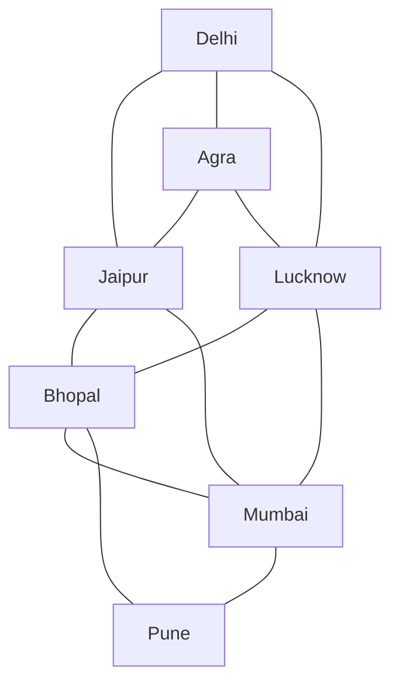

# ✈️ Intelligent Travel Planner

### Smart Route Recommendation System | MCA – Artificial Intelligence Lab Test 2


A route-planning project that explores connections between Indian cities and recommends a suitable journey based on travel cost, time, or distance.

---
DEMO-VIDE0 Link: https://drive.google.com/file/d/1uu7cGHuQffEOHGpE2prB6pWRcbbO3YIp/view?usp=drive_link

## 📑 Navigation

| Section | Description |
|---|---|
| [About](#-about-the-project) | Project introduction |
| [Problem](#-problem-statement) | What the system solves |
| [City Network](#-city-network) | Visual representation |
| [Connections](#-connection-details) | City-to-city data |
| [Logic](#-how-the-system-works) | Prolog implementation |
| [Features](#-features) | Main capabilities |
| [Execution](#-running-the-project) | How to run the program |
| [Testing](#-test-cases-and-results) | Verified test results |
| [Conclusion](#-conclusion) | Project summary |

---

## 🌍 About the Project

The Intelligent Travel Planner is a Prolog-based application developed for the MCA Artificial Intelligence Lab Test 2.

The idea behind this project is simple: when travelling between two cities, different people may have different priorities. Some may want to spend less money, while others may prefer to save time or travel a shorter distance.

This program explores the available routes and recommends one according to the selected preference.

### The three travel preferences

| Preference | What it optimizes |
|---|---|
| 💰 Cheapest | Total travel cost |
| ⚡ Fastest | Total travel time |
| 📍 Shortest | Total travel distance |

## 🎯 Problem Statement

Develop a Prolog-based intelligent travel planner that represents a network of cities and their connections. The program should accept a source city and destination city, find possible routes, calculate their total cost, time and distance, and recommend a route according to the traveller's preference.

## 🎯 Project Objectives

- Represent at least six cities and their connections.
- Store distance, travel time and cost for every connection.
- Find routes between a given source and destination.
- Recommend the cheapest, fastest or shortest route.
- Calculate the total values for the selected route.
- Allow a city to be excluded from route searching.
- Handle unavailable connections.
- Display multiple possible routes.
- Compare cheapest and fastest route recommendations.
- Validate interactive user input.

---

## 🗺️ City Network

The project contains **7 cities connected through 12 connection facts**.

The connections are treated as bidirectional by the Prolog rules.



### Cities included

| No. | City |
|---:|---|
| 1 | Delhi |
| 2 | Jaipur |
| 3 | Agra |
| 4 | Lucknow |
| 5 | Bhopal |
| 6 | Mumbai |
| 7 | Pune |

---

## 📊 Connection Details

Every connection stores three important values: cost, time and distance.

The Prolog fact format used is:

`link(Source, Destination, Cost, Time, Distance).`

| No. | Connection | Cost (₹) | Time (hrs) | Distance (km) |
|---:|---|---:|---:|---:|
| 1 | Delhi – Jaipur | 2,500 | 5 | 280 |
| 2 | Delhi – Agra | 1,800 | 4 | 230 |
| 3 | Delhi – Lucknow | 3,200 | 8 | 550 |
| 4 | Agra – Jaipur | 1,500 | 4 | 240 |
| 5 | Agra – Lucknow | 2,100 | 5 | 335 |
| 6 | Jaipur – Bhopal | 3,500 | 8 | 600 |
| 7 | Jaipur – Mumbai | 9,000 | 17 | 1,150 |
| 8 | Lucknow – Bhopal | 2,800 | 7 | 570 |
| 9 | Lucknow – Mumbai | 7,500 | 18 | 1,350 |
| 10 | Bhopal – Mumbai | 4,000 | 10 | 780 |
| 11 | Bhopal – Pune | 3,000 | 7 | 600 |
| 12 | Mumbai – Pune | 1,200 | 3 | 150 |

**Special condition:** The Delhi–Agra connection is temporarily marked unavailable in the current implementation.

---

## ⚙️ How the System Works

The project uses Prolog facts, rules, recursion, backtracking and list processing.

### 1. Representing connections

The `link/5` predicate stores the connection details.

```prolog
link(delhi, jaipur, 2500, 5, 280).
link(delhi, agra, 1800, 4, 230).
```

The arguments represent the source city, destination city, cost, time and distance.

### 2. Checking connections

The `connection/5` predicate checks connections in both directions. It also checks whether a connection has been marked unavailable.

### 3. Finding possible routes

The `travel_path/4` and `search_path/5` predicates use recursive searching to find paths between cities.

A visited-city list prevents the search from visiting the same city repeatedly within a route.

### 4. Calculating totals

The `calculate_totals/4` predicate adds the cost, time and distance of each connection in a selected path.

### 5. Selecting the recommended route

The `best_route/8` predicate performs the optimization:

1. Collects possible routes using `findall/3`.
2. Calculates the totals for each route.
3. Selects the required value using `preference_value/5`.
4. Sorts the candidates using `keysort/2`.
5. Selects the route with the lowest value for the chosen preference.

---

## ✨ Features

| Feature | Functionality |
|---|---|
| Cheapest Route | Finds the route with minimum total cost |
| Fastest Route | Finds the route with minimum total time |
| Shortest Route | Finds the route with minimum total distance |
| Avoid City | Excludes a specified city from the search |
| Unavailable Connection | Prevents travel through a closed connection |
| Multiple Routes | Displays possible routes |
| Route Comparison | Displays cheapest and fastest recommendations |
| Input Validation | Checks city names and preferences |

---

## 💻 Running the Project

### Requirements

- Windows
- SWI-Prolog
- Project source file: `intelligent_travel_planner.pl`

### Step 1 – Open SWI-Prolog

Install and launch SWI-Prolog.

### Step 2 – Load the program

Use the following command with the location of your downloaded source file:

```prolog
consult('intelligent_travel_planner.pl').
```

### Step 3 – Start the planner

```prolog
start.
```

### Step 4 – Enter travel details

Example:

```text
Enter Source City: delhi.
Enter Destination City: mumbai.
Choose Preference (cheapest/fastest/shortest): cheapest.
```

### Additional queries

To display available routes:

```prolog
show_routes(delhi, mumbai).
```

To compare the cheapest and fastest routes:

```prolog
compare_routes(delhi, mumbai).
```

To directly request a particular preference:

```prolog
planner(delhi, mumbai, cheapest, none).
```

---

## 🧪 Test Cases and Results

The following are results from the project's tested queries.

### Test 1 – Cheapest Route

**Query**

```prolog
planner(delhi, mumbai, cheapest, none).
```

**Result**

```text
Recommended Route: delhi -> jaipur -> bhopal -> mumbai
Total Cost: Rs. 10000
Travel Time: 23 hours
Total Distance: 1660 km
Reason: Selected according to cheapest preference.
```

### Test 2 – Fastest Route

**Query**

```prolog
planner(delhi, mumbai, fastest, none).
```

**Result**

```text
Recommended Route: delhi -> jaipur -> mumbai
Total Cost: Rs. 11500
Travel Time: 22 hours
Total Distance: 1430 km
Reason: Selected according to fastest preference.
```

### Test 3 – Shortest Route

**Query**

```prolog
planner(delhi, mumbai, shortest, none).
```

**Result**

```text
Recommended Route: delhi -> jaipur -> mumbai
Total Cost: Rs. 11500
Travel Time: 22 hours
Total Distance: 1430 km
Reason: Selected according to shortest preference.
```

### Test 4 – Avoiding a City

**Query**

```prolog
planner(delhi, mumbai, cheapest, jaipur).
```

**Result**

```text
Recommended Route: delhi -> lucknow -> bhopal -> mumbai
Total Cost: Rs. 10000
Travel Time: 25 hours
Total Distance: 1900 km
Reason: Selected according to cheapest preference.
```

### Test 5 – Unavailable Connection

**Query**

```prolog
planner(delhi, agra, cheapest, none).
```

**Result**

```text
Recommended Route: delhi -> jaipur -> agra
Total Cost: Rs. 4000
Travel Time: 9 hours
Total Distance: 520 km
Reason: Selected according to cheapest preference.
```

### Test 6 – Invalid Input

**Input:** The destination is entered as `xyz` using the interactive `start/0` predicate.

**Result**

```text
Invalid Input! Please enter valid cities and preference.
```

---

## 📁 Project Structure

```text
Intelligent-Travel-Planner/
│
├── README.md
│
└── intelligent_travel_planner.pl
```

---

## 🏁 Conclusion

Building this project helped demonstrate how Prolog can be used to represent a network and solve a practical route-planning problem.

The program combines facts, rules, recursive path searching and route optimization to recommend a route based on the traveller's preference.

It also includes additional functionality such as avoiding cities, handling unavailable connections, displaying multiple routes and comparing recommendations.

**MCA – Artificial Intelligence Lab Test 2**

*Intelligent Travel Planner — Smart Routes, Better Travel!* 
